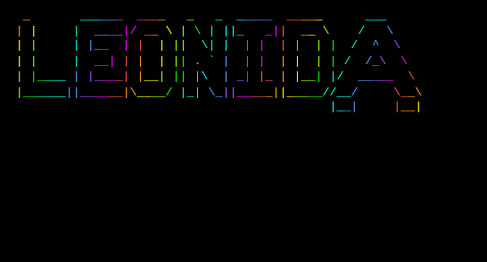

<h1 align="center">
   
  
</h1>
<h2 align="center">  
  
  
  
  
  
  
</h2>
<h4 align="center">Grand Theft Auto VI (Xbox Series) running natively on Windows or Linux, built on your PC from your own copy, forked from the original Leonida by NotRexed
</h4>

PROJECT ON GITLAB: https://gitlab.com/BasGame1/gta2pc

  <a href="https://gitlab.com/BasGame1/gta2pc/docs/i18n/README.md">Other languages</a> |
  <a href="https://gitlab.com/BasGame1/gta2pc#how-to-build">How to build</a> |
  <a href="https://gitlab.com/BasGame1/gta2pc#how-it-works">How it works</a> |
  <a href="https://gitlab.com/BasGame1/gta2pc#want-to-help">Want to help?</a> |
  <a href="https://gitlab.com/BasGame1/gta2pc#credits">Credits</a> |
  <a href="https://gitlab.com/BasGame1/gta2pc#license">License</a> |
  <a href="https://gitlab.com/BasGame1/gta2pc/docs/status.md">Status</a> |
  <a href="https://gitlab.com/BasGame1/gta2pc/docs/objectives.md">Objectives</a> |
  <a href="https://t.me/PixelifyNext">Telegram</a>

Leonida is a static recompilation project. The Xbox Series CPU is x86-64 like a PC, so the game's code is loaded
and run natively, and the console's system software is reimplemented. The console's precompiled RDNA2 GPU programs
are translated to SPIR-V for Vulkan. The game's models, textures and audio are read from your package. All of this
happens **on your PC, from your own legal obtained copy of the game**.

> [!IMPORTANT]
> This repository **does not contain the game, keys or an executable**, and it does not explain how to get them. You
> need your own copy, with its files already readable on disk. Nothing here decrypts or works around any protection.
> Everything the build creates (the generated shaders, extracted assets, the runtime folder and your saves) comes
> from your game and stays on your PC. Never share those files.

Telegram: https://t.me/PixelifyNext

 

